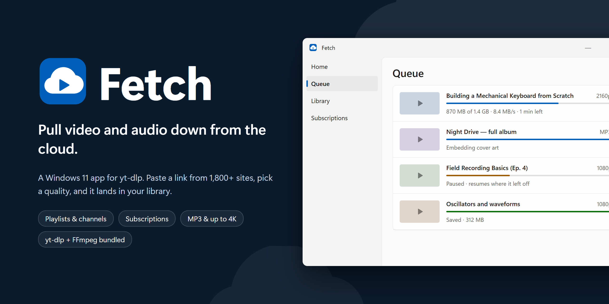

# Fetch



A desktop app for Windows 11, macOS and Linux for downloading video and audio, built with Electron on top of [yt-dlp](https://github.com/yt-dlp/yt-dlp).

- **Home:** paste a link, or type words to search YouTube, then pick a quality preset or exact formats.
- **Playlists and channels:** pick the items you want and filter them by length, title, upload date or what you already have.
- **Queue:** live progress, pause and resume, and the number of downloads at once.
- **Library:** everything you've downloaded; right-click to play, re-download, save as MP3 or split by chapters.
- **Subscriptions:** new uploads from channels and playlists download on a schedule.
- Light and dark themes, a Mica background, a tray icon, and clipboard link detection.

## Install

Download `Fetch Setup <version>.exe` from [Releases](../../releases). It includes yt-dlp and an LGPL build of FFmpeg. For YouTube, also install Deno ([see below](#youtube-and-deno)).
The installer is not code-signed yet, so Windows SmartScreen will warn about an unknown publisher.

**macOS:** download `Fetch-<version>-arm64.dmg` (Apple silicon) or `Fetch-<version>.dmg` (Intel). It includes yt-dlp but not FFmpeg (no LGPL macOS build is published), so also run `brew install ffmpeg deno`. The app is not signed: right-click it → Open the first time.

**Linux:** download `Fetch-<version>.AppImage`, `chmod +x` it and run it. It includes yt-dlp and an LGPL build of FFmpeg. In-app yt-dlp updates don't work inside an AppImage; update by downloading a newer Fetch.

## YouTube and Deno

For YouTube, also install [Deno](https://deno.com), a JavaScript runtime:

```powershell
winget install DenoLand.Deno
```

Then restart Fetch. Settings → Components shows whether Deno was found.

**Why it's needed:** YouTube scrambles its video links with JavaScript in its web player, and changes that code every few weeks. yt-dlp unscrambles them by running YouTube's own player code locally, in Deno.

**What happens without it:** Fetch still works, but YouTube offers only a limited set of streams. The best qualities can be missing, and downloads stall or fail more often. Home shows a yellow banner when you paste a YouTube link without Deno installed.

**What it doesn't affect:** other sites don't need Deno. yt-dlp only uses it while reading a YouTube page, and Fetch does nothing else with it. Deno isn't bundled in the installer yet.

## Develop

Needs Node.js 22+. When run from source, the app uses `yt-dlp` and `ffmpeg` from your PATH.

```powershell
npm install
npm start
npm test
```

## Build the installer

```powershell
npm run dist
```

Run it on the OS you are building for (Windows → `.exe`, macOS → `.dmg`, Linux → `.AppImage`); the [build workflow](.github/workflows/build.yml) builds all three on GitHub Actions when you push a `v*` tag or run it by hand.
On Windows this draws `build/icon.ico`, copies yt-dlp into `vendor/bin`, downloads the FFmpeg-Builds LGPL shared build once (into `vendor/cache`), and writes `dist/Fetch Setup <version>.exe`.
Set `YTDLP_EXE` or `FFMPEG_DIR` to use other binaries; GPL and nonfree FFmpeg builds are rejected.

## Licence

Fetch is released under the [MIT License](LICENSE). The bundled tools keep their own licences, listed below.

## Third-party software

- [yt-dlp](https://github.com/yt-dlp/yt-dlp): Unlicense.
- [FFmpeg](https://ffmpeg.org): LGPL v2.1 or later. The installer ships its licence and a source notice (`FFMPEG-LICENSE.txt`, `FFMPEG-SOURCE.txt`).
